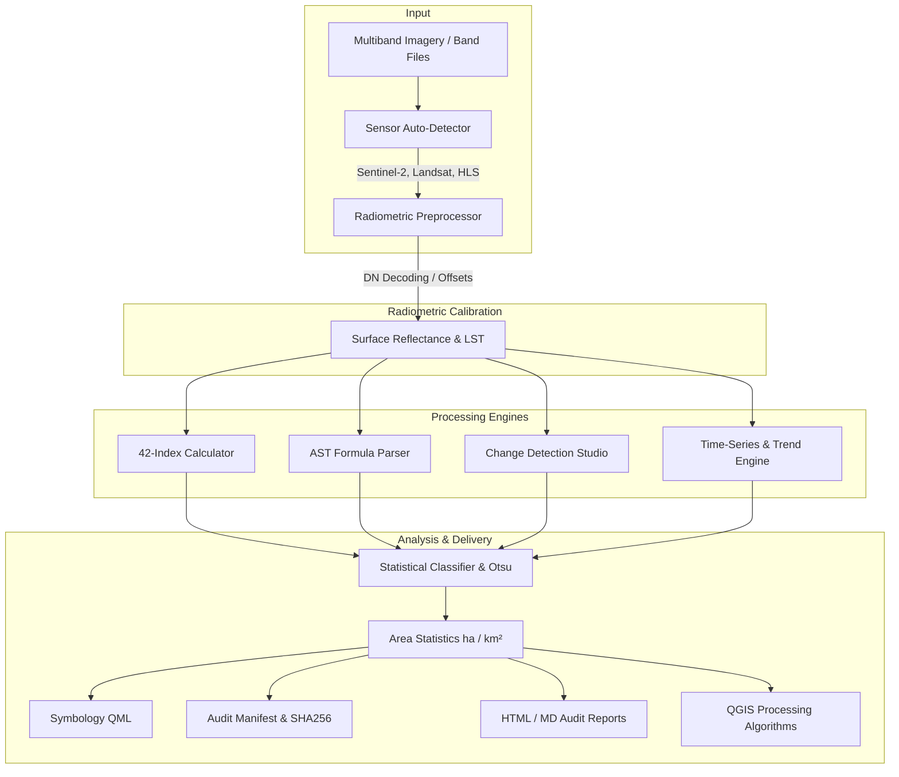

<p align="center">
  
</p>

# AriesLegacy — Scientific Satellite Remote Sensing Workbench for QGIS

[](https://qgis.org)
[](LICENSE)
[](CHANGELOG.md)
[](tests/)
[](processing/)

**AriesLegacy** is a professional, scientifically rigorous satellite remote sensing workbench for QGIS. It delivers automated sensor profile detection, TOA-to-BOA atmospheric correction (Automatic Mode & Advanced 6S Radiative Transfer), physical radiometric calibration, 42 peer-reviewed spectral indices, a safe AST custom formula builder, two-date change detection, multi-temporal trend analytics (OLS, Theil-Sen, Mann-Kendall), statistical classification, and research-grade HTML/Markdown audit reports.

> **Scientific Transparency & Scope Lock:** AriesLegacy strictly relies on deterministic, peer-reviewed remote sensing equations, published calibration coefficients, and verified statistical estimators. It contains **no chatbot, no generative AI, and no unvetted cloud dependencies**.

---

## 🌟 Key Features

### 1. TOA-to-BOA Atmospheric Correction Suite (AL-ATM-BOOK-2.0)
- **Mode A — Automatic Mode (`AUT-001`)**:
  - Automatically inspects product metadata, containers, and sidecars (`ProductInspector`).
  - Detects physical radiometric state: `RAW_DN`, `TOA_REFLECTANCE`, `BOA_SCALED`, `BOA_REFLECTANCE`.
  - **Invariant Protection**: Authentic Level-2 BOA products (Landsat Collection 2 L2 and Sentinel-2 L2A) are decoded directly; duplicate atmospheric correction is strictly prohibited to prevent data corruption.
  - Automatically routes Level-1 scenes to verified installed processors (ESA Sen2Cor for Sentinel-2 L1C, official USGS L2 for Landsat).
  - Transparent fallback: If an external atmospheric backend is unavailable, exports calibrated TOA reflectance with explicit labeling (`BOA_UNAVAILABLE_TOA_ONLY`).
- **Mode B — Advanced 6S Physical Radiative Transfer (`ADV-001` - `ADV-006`)**:
  - Parametric atmospheric forward model based on 6S (6SV-2.1).
  - Explicit control over Solar Zenith Angle ($SZA$), Aerosol Optical Depth ($AOT_{550}$), aerosol profiles (Continental, Maritime, Urban, Desert, Biomass Burning), total column water vapour ($WV$), ozone ($O_3$), and surface elevation/pressure.
  - Computes band-specific atmospheric coefficients ($\rho_{path}, T_{eff}, S$) and standard 6S formulation ($x_a, x_b, x_c$).
  - Inverts TOA reflectance to physical BOA surface reflectance: $\rho_{BOA} = (\rho_{TOA} - \rho_{path}) / (T_{eff} + S(\rho_{TOA} - \rho_{path}))$.
  - Sensitivity and uncertainty analysis ($\Delta\rho = \rho_{high} - \rho_{low}$) across perturbed parameter scenarios.
  - Exploratory Dark Object Subtraction option (`DOS_APPROXIMATION`).
  - Scientific comparator calculating per-band Bias, MAE, RMSE, and Pearson correlation $r$ against reference Level-2 imagery.
- **Quality Masking (`QA-001`)**:
  - Landsat Collection 2 `QA_PIXEL` and Sentinel-2 `SCL` screening under `conservative`, `standard`, and `relaxed` policies.

### 2. Calibrated Optical Preprocessing & Radiometry
- **Landsat Collection 2 Level-1**: Converts raw DN to spectral radiance (PRE-001) and TOA planetary reflectance (PRE-002) with sun elevation correction.
- **Sentinel-2 Level-1C**: Decodes integer DN to TOA reflectance using `QUANTIFICATION_VALUE` (PRE-004).
- **Landsat Collection 2 Level-2**: Calibrates Surface Reflectance ($\text{SR} = 0.0000275 \times \text{DN} - 0.2$) with explicit DN=0 fill masking (PRE-005).
- **Sentinel-2 Level-2A**: Decodes BOA Surface Reflectance with automatic handling of processing baseline `04.00+` BOA offsets ($-1000$ DN) (PRE-006).
- **Dark Object Subtraction (DOS)**: Atmospheric path radiance estimation and surface reflectance approximation (PRE-008).
- **Thermal Radiometry**: Planck inversion for At-Sensor Brightness Temperature and Landsat Collection 2 L2 Surface Temperature in Celsius (PRE-009).
- **Quality Assessment Masks**: Bitwise decoding for Landsat `QA_PIXEL` (cirrus, cloud, cloud shadow, dilated cloud) and Sentinel-2 `SCL` scene classification (PRE-010, PRE-011).

### 2. Complete 42-Index Scientific Library
Comprehensive index coverage across 7 remote sensing domains:
- **Vegetation & Chlorophyll**: NDVI, GNDVI, EVI, EVI2, SAVI, MSAVI, OSAVI, NDRE, MTCI, CI_green, CI_re, ARI, CRI, VARI, SIPI.
- **Water & Flood**: NDWI, MNDWI, AWEI_nsh, AWEI_sh, WI.
- **Moisture & Drought**: NDMI, MSI, NMDI.
- **Built-Up & Impervious Surfaces**: NDBI, UI, NDISI, EBBI, IBI.
- **Soil, Mineral & Mining**: BSI, Clay Ratio, Iron Oxide Ratio, Ferrous Iron Ratio.
- **Fire & Burn Severity**: NBR, NBR2, BAI, dNBR, RdNBR, RBR, MIRBI.
- **Cryosphere & Snow**: NDSI, NDGI, S3.
- **Thermal**: Land Surface Temperature in Celsius (LST_C).

### 3. Safe AST Custom Formula Engine
- Evaluate custom mathematical expressions (e.g. `(NIR - RED) / (NIR + RED + 0.16)`) securely.
- Uses Python Abstract Syntax Tree (AST) inspection without `eval()` or `exec()`.
- Whitelist of mathematical functions: `sqrt`, `abs`, `min`, `max`, `log`, `exp`, `sin`, `cos`, `safe_divide`.
- Automated zero-division safety and NoData handling (`-9999.0`).

### 4. Advanced Two-Date Change Detection Studio
- **Signed & Relative Difference**: $\Delta = Post - Pre$ and percentage change.
- **Post-Wildfire Burn Severity**: Standardized differenced NBR ($\text{dNBR} = Pre - Post$) with USGS/USFS severity classifications (Key & Benson, 2006).
- **Relativized Burn Severity**: RdNBR (Miller & Thode, 2007) and RBR (Parks et al., 2014) for sparse ecosystems.
- **Change Vector Analysis (CVA)**: Multi-spectral magnitude and direction angle.
- **Categorical Transition Matrix**: Cross-tabulation of thematic classes between two dates with gain, loss, and persistence statistics.

### 5. Multi-Temporal Time-Series Analytics
- **Ordinary Least Squares (OLS) Trend**: Pixel-level linear slope ($\beta_1$) and $R^2$ goodness of fit.
- **Theil-Sen Robust Estimator**: Non-parametric median pairwise slope resistant to cloud contamination and outliers.
- **Mann-Kendall Monotonic Trend Test**: Calculates Mann-Kendall $S$, tie-corrected variance $\text{Var}(S)$, standardized $Z$-score, and two-tailed $p$-values.
- **Baseline Anomaly Tracking**: Absolute anomalies and standardized $Z$-score anomalies.
- **Temporal Compositing**: Pixel-level cloud-free composite generation using **Median**, **Maximum**, or **Mean**.

### 6. Thematic Classification & Exact Area Accounting
- **Statistical Thresholding**: Manual breaks, Equal Interval, Empirical Quantile, Fisher-Jenks Natural Breaks, and Standard Deviation intervals.
- **Otsu Automated Thresholding**: Optimal bimodal raster binarization maximizing inter-class variance with plateau midpoint averaging.
- **Precision Area Accounting**: Exact surface area calculation in **Hectares ($ha$)**, **Square Kilometres ($km^2$)**, **Square Metres ($m^2$)**, and percentage coverage.

### 7. Research-Grade Audit Reports & Provenance
- Outputs print-ready HTML and Markdown audit dossiers embedding the official AriesLegacy banner.
- Cryptographic SHA256 input and output checksums for full scientific reproducibility.
- Detailed parameter logging, sensor acquisition metadata, formula definitions, and peer-reviewed literature citations.

### 8. Native QGIS Processing Toolbox Provider
All algorithms are registered under provider ID `arieslegacy`, fully accessible via the **QGIS Processing Toolbox**, the **Graphical Modeler**, and PyQGIS scripting.

---

## 🏛️ System Architecture



---

## 📦 Installation

### Option 1: Install from ZIP in QGIS
1. Download `AriesLegacy.zip` from [Releases](https://github.com/Hendrcks/AriesLegacy/releases).
2. Open QGIS.
3. In the menu, go to **Plugins** > **Manage and Install Plugins...**
4. Select **Install from ZIP** on the left menu.
5. Browse to `AriesLegacy.zip` and click **Install Plugin**.
6. Activate **AriesLegacy** in the **Installed** tab.

### Option 2: Manual Directory Installation
Clone or copy the `AriesLegacy` repository into your QGIS 3 plugins directory:
- **Windows**: `%APPDATA%\QGIS\QGIS3\profiles\default\python\plugins\AriesLegacy`
- **macOS**: `~/Library/Application Support/QGIS/QGIS3/profiles/default/python/plugins/AriesLegacy`
- **Linux**: `~/.local/share/QGIS/QGIS3/profiles/default/python/plugins/AriesLegacy`

---

## 🚀 Quick Start Guide (Sentinel-2 NDVI in 3 Steps)

1. **Load Sentinel-2 Imagery**: Add your Sentinel-2 L2A multiband composite or individual band rasters to your QGIS map canvas.
2. **Open AriesLegacy**: Click the **AriesLegacy** satellite icon on the raster toolbar to open the dock panel.
3. **Run Calibrated Calculation**:
   - In the **Quick Index** tab, select your raster layer.
   - AriesLegacy detects `Sentinel-2 MSI Level-2A` and automatically assigns `B08 (NIR)` and `B04 (RED)`.
   - Select `NDVI — Normalized Difference Vegetation Index`.
   - Click **⚡ Calculate Index**.
   - The styled, calibrated NDVI layer is immediately loaded onto your QGIS map canvas!

---

## 📚 Complete 42-Index Catalog

| Group | Index | Canonical Formula | Primary Application |
| :--- | :--- | :--- | :--- |
| **Vegetation** | **NDVI** | $(NIR - RED) / (NIR + RED)$ | General vegetation vigor & canopy density |
| **Vegetation** | **GNDVI** | $(NIR - GREEN) / (NIR + GREEN)$ | Chlorophyll concentration & crop nitrogen |
| **Vegetation** | **EVI** | $2.5(NIR - RED) / (NIR + 6 RED - 7.5 BLUE + 1)$ | High-biomass dense forest monitoring |
| **Vegetation** | **EVI2** | $2.5(NIR - RED) / (NIR + 2.4 RED + 1)$ | Two-band enhanced vegetation index |
| **Vegetation** | **SAVI** | $((NIR - RED) / (NIR + RED + 0.5)) \times 1.5$ | Semi-arid vegetation & soil background reduction |
| **Vegetation** | **MSAVI** | $(2 NIR + 1 - \sqrt{(2 NIR + 1)^2 - 8(NIR - RED)}) / 2$ | Self-adjusting soil background correction |
| **Vegetation** | **OSAVI** | $(NIR - RED) / (NIR + RED + 0.16)$ | Optimized canopy soil background adjustment |
| **Vegetation** | **NDRE** | $(NIR - RED\_EDGE\_1) / (NIR + RED\_EDGE\_1)$ | Precision agriculture & late-stage crop vigor |
| **Vegetation** | **MTCI** | $(RED\_EDGE\_2 - RED\_EDGE\_1) / (RED\_EDGE\_1 - RED)$ | Terrestrial chlorophyll content tracking |
| **Vegetation** | **CI_green** | $(NIR / GREEN) - 1.0$ | Green chlorophyll index for crop canopies |
| **Vegetation** | **CI_re** | $(NIR / RED\_EDGE\_1) - 1.0$ | Red-edge chlorophyll index |
| **Vegetation** | **ARI** | $(1.0 / GREEN) - (1.0 / RED\_EDGE\_1)$ | Anthocyanin accumulation & plant stress |
| **Vegetation** | **CRI** | $(1.0 / BLUE) - (1.0 / GREEN)$ | Carotenoid pigment concentration |
| **Vegetation** | **VARI** | $(GREEN - RED) / (GREEN + RED - BLUE)$ | RGB atmospheric resistant vegetation fraction |
| **Vegetation** | **SIPI** | $(NIR - BLUE) / (NIR - RED)$ | Carotenoid to chlorophyll ratio |
| **Water / Flood** | **NDWI** | $(GREEN - NIR) / (GREEN + NIR)$ | Open surface water delineation |
| **Water / Flood** | **MNDWI** | $(GREEN - SWIR_1) / (GREEN + SWIR_1)$ | Surface water delineation & urban flood mapping |
| **Water / Flood** | **AWEI_nsh** | $4(GREEN - SWIR_1) - (0.25 NIR + 2.75 SWIR_2)$ | Stable shadow-resistant water extraction |
| **Water / Flood** | **AWEI_sh** | $BLUE + 2.5 GREEN - 1.5(NIR + SWIR_1) - 0.25 SWIR_2$ | Urban & mountain shadow water extraction |
| **Water / Flood** | **WI** | $1.7204 + 171 G + 3 R - 70 NIR - 45 SWIR_1 - 71 SWIR_2$ | Multi-spectral water classification model |
| **Moisture** | **NDMI** | $(NIR - SWIR_1) / (NIR + SWIR_1)$ | Canopy water content & drought stress |
| **Moisture** | **MSI** | $SWIR_1 / NIR$ | Canopy moisture stress ratio |
| **Moisture** | **NMDI** | $(NIR - (SWIR_1 - SWIR_2)) / (NIR + (SWIR_1 - SWIR_2))$ | Normalized multi-band drought index |
| **Built-Up** | **NDBI** | $(SWIR_1 - NIR) / (SWIR_1 + NIR)$ | Urban settlement & impervious footprint |
| **Built-Up** | **UI** | $(SWIR_2 - NIR) / (SWIR_2 + NIR)$ | Urban infrastructure mapping |
| **Built-Up** | **NDISI** | $(THERMAL - (MNDWI + NIR + SWIR_1)/3) / (\dots)$ | Thermal-optical impervious surface index |
| **Built-Up** | **EBBI** | $(SWIR_1 - NIR) / (10 \sqrt{SWIR_1 + THERMAL})$ | Built-up and bareness differentiation |
| **Built-Up** | **IBI** | $(NDBI - (SAVI + MNDWI)/2) / (NDBI + (\dots)/2)$ | Index-based built-up extraction |
| **Soil / Mining** | **BSI** | $((SWIR_1 + RED) - (NIR + BLUE)) / (\dots)$ | Bare ground, excavation pits & mine disturbance |
| **Soil / Mining** | **Clay Ratio** | $SWIR_1 / SWIR_2$ | Clay mineral alteration & hydrothermal zones |
| **Soil / Mining** | **Iron Oxide** | $RED / BLUE$ | Gossan zones, iron enrichment & mine tailings |
| **Soil / Mining** | **Ferrous Iron**| $SWIR_1 / NIR$ | Iron-bearing silicates & mining waste rock |
| **Fire / Burn** | **NBR** | $(NIR - SWIR_2) / (NIR + SWIR_2)$ | Pre-fire and post-fire canopy baseline |
| **Fire / Burn** | **NBR2** | $(SWIR_1 - SWIR_2) / (SWIR_1 + SWIR_2)$ | Non-photosynthetic vegetation (NPV) & litter |
| **Fire / Burn** | **BAI** | $1.0 / ((0.1 - RED)^2 + (0.06 - NIR)^2)$ | Charcoal and ash deposit detection |
| **Fire / Burn** | **dNBR** | $NBR_{pre} - NBR_{post}$ | Post-wildfire burn severity (USGS / USFS) |
| **Fire / Burn** | **RdNBR** | $(NBR_{pre} - NBR_{post}) / \sqrt{\|NBR_{pre}\| + 0.001}$ | Relativized burn ratio for sparse canopies |
| **Fire / Burn** | **RBR** | $(NBR_{pre} - NBR_{post}) / (NBR_{pre} + 1.001)$ | Relativized burn ratio robust to zero/negative NBR |
| **Fire / Burn** | **MIRBI** | $10.0\,SWIR_2 - 9.8\,SWIR_1 + 2.0$ | Shrubland and arid fire scar discrimination |
| **Cryosphere** | **NDSI** | $(GREEN - SWIR_1) / (GREEN + SWIR_1)$ | Snow and ice delineation separating cloud |
| **Cryosphere** | **NDGI** | $(GREEN - RED) / (GREEN + RED)$ | Glacier ice detection & debris margin tracking |
| **Cryosphere** | **S3** | $NIR(GREEN - SWIR_1) / ((NIR + GREEN)(NIR + SWIR_1))$ | Snow detection under forest canopy |
| **Thermal** | **LST_C** | $(THERMAL \times 0.00341802 + 149.0) - 273.15$ | Land Surface Temperature in Celsius ($^\circ\text{C}$) |

---

## 🧪 Testing & Verification

AriesLegacy includes an automated test suite verifying all 42 spectral index equations, AST mathematical safety, radiometric scalings, time-series slope/significance tests, and classification routines:

```bash
python -m unittest discover -s tests -p "test_*.py"
```

All **48 comprehensive unit, specification, and atmospheric correction tests** pass cleanly with 100% compliance against the AriesLegacy Scientific Formula Sheet and AL-ATM-BOOK-2.0.

---

## 📄 License & Attribution

Licensed under the **GNU General Public License v2.0 or later (GPL-2.0-or-later)**.  
Developed by **AriesPlus Geospatial Solutions**.
